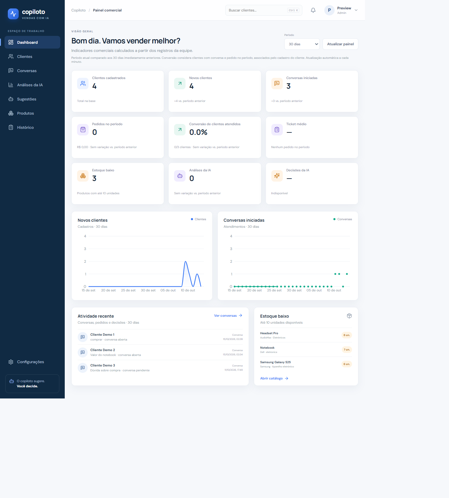
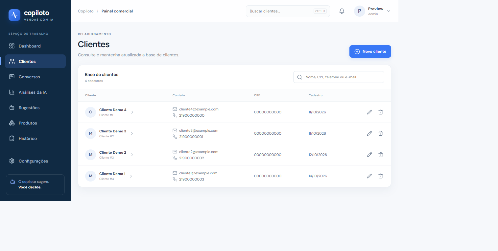
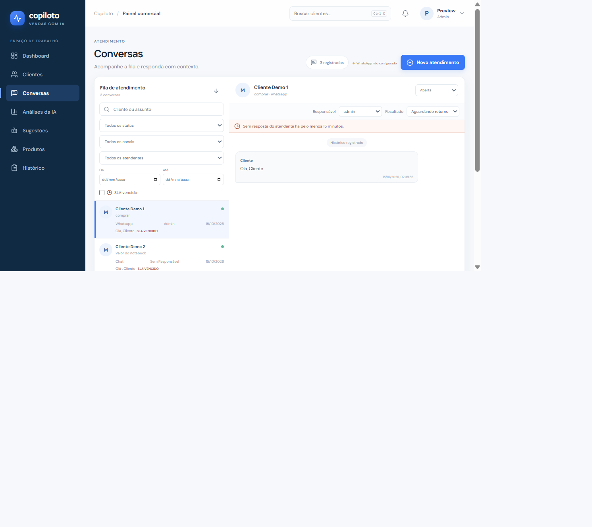
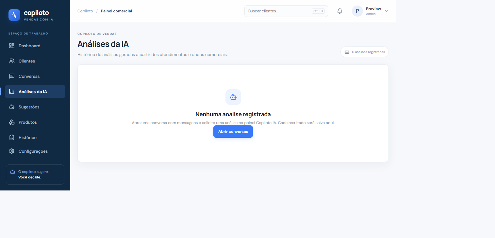
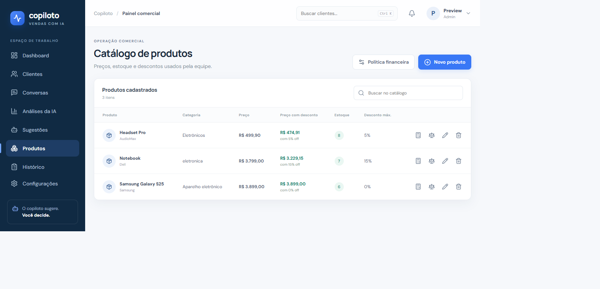
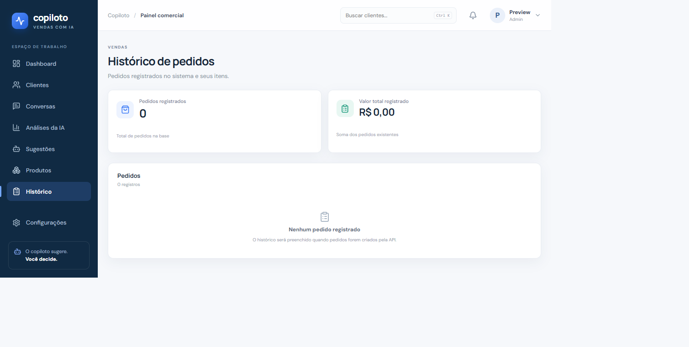

Copiloto de Vendas com IA
API de vendas e atendimento desenvolvida com FastAPI, SQLAlchemy e PostgreSQL/SQLite. O painel administrativo utiliza React, Vite e React Router para consumir os endpoints da API.

## Capturas da interface

Visão das principais telas do espaço de trabalho:

| Dashboard | Clientes |
| --- | --- |
|  |  |

| Conversas | Análises da IA |
| --- | --- |
|  |  |

| Sugestões | Produtos |
| --- | --- |
|  |  |

| Histórico |
| --- |
|  |

Desenvolvimento em colaboração com IA
Este projeto é uma iniciativa de portfólio conduzida por mim, com apoio de ferramentas de Inteligência Artificial durante o processo de desenvolvimento. Utilizo a IA como parceira para explorar alternativas, discutir soluções técnicas, auxiliar na implementação, investigar erros e aprimorar testes e documentação.
A colaboração não elimina a necessidade de avaliação humana. As sugestões precisam ser revisadas, executadas e testadas antes de serem consideradas parte do projeto. Meu objetivo é compreender progressivamente a arquitetura e as decisões técnicas, validar o comportamento da aplicação e assumir responsabilidade pelo resultado.
O projeto também funciona como um ambiente prático de aprendizagem em desenvolvimento backend, integração de serviços, segurança, persistência de dados e testes automatizados. A documentação distingue as funcionalidades implementadas das limitações conhecidas e dos próximos passos.
O que já funciona
- Cadastro, edição, consulta e exclusão de clientes.
- Catálogo com cadastro de produtos, preços, estoque e limite de desconto. O painel calcula e exibe o preço final aplicando o desconto máximo permitido.
- Consulta de pedidos e totais registrados.
- Fila de conversas, histórico de mensagens, atualização de status e envio de respostas.
- Dashboard com indicadores calculados a partir dos registros disponíveis na API.
- Cadastro de usuários e permissões por perfil.
- Deploy de API e painel pelo mesmo App Service, com PostgreSQL Flexible Server.
- Análises de conversas com IA: identifica intenção de compra e objeções, recomenda produtos com base no catálogo e nos pedidos e prepara uma resposta para revisão.
- Histórico persistente de análises, sugestões e decisões: aceitações e rejeições relacionadas ao usuário; sugestões de resposta passam a ser enviadas junto com a mensagem real, preservando o texto revisado.
A análise utiliza a API da OpenAI. Configure OPENAI_API_KEY no arquivo .env. O texto das mensagens é enviado à OpenAI somente quando um usuário solicita uma análise. A resposta sugerida é apresentada para revisão e não é enviada automaticamente.
Atendimento via WhatsApp
O canal utiliza a WhatsApp Cloud API da Meta. Configure no arquivo .env as variáveis META_ACCESS_TOKEN, META_PHONE_NUMBER_ID, META_APP_SECRET e META_VERIFY_TOKEN e reinicie a API. O token de verificação é definido por você e deve corresponder ao valor configurado no painel da Meta. META_GRAPH_API_VERSION é opcional; se omitida, a aplicação utiliza v23.0. Nunca coloque credenciais reais no repositório.
Cadastre https://<dominio-publico-da-api>/webhooks/whatsapp como URL de callback no painel da Meta, informe o token de verificação e assine o campo messages do webhook da conta WhatsApp Business. O endpoint precisa ser acessível publicamente por HTTPS. Mensagens recebidas em texto são deduplicadas pelo ID do provedor; quando o telefone ainda não existe, o sistema cria o cliente e inicia/reutiliza uma conversa no WhatsApp. Mensagens recebidas de outros tipos são ignoradas nesta versão.
As respostas dos participantes em conversas do canal WhatsApp são enviadas pela Cloud API. A Meta aplica a janela de atendimento e pode exigir modelos aprovados fora dela. O envio por modelo e os callbacks de entrega/leitura ainda não estão implementados; recusas da Meta são exibidas ao atendente. O webhook não cria lembretes externos. Conversas com mensagem do cliente sem resposta por 15 minutos ficam sinalizadas na fila e podem ser filtradas por SLA vencido.
Estrutura do frontend
frontend/
  src/
    components/   componentes visuais reutilizáveis
    hooks/        carregamento e estado de dados
    layouts/      navegação e estrutura responsiva
    pages/        dashboard, clientes, conversas e demais páginas
    services/     chamadas HTTP e autenticação
    App.jsx       rotas do React Router
    main.jsx      inicialização da aplicação
    styles.css    identidade visual e responsividade

Desenvolvimento local
Instale as dependências do Python e prepare o arquivo de ambiente:
python -m pip install -r requirements.txt
Copy-Item .env.example .env
python -m alembic upgrade head
# Edite .env e configure OPENAI_API_KEY com sua chave da API da OpenAI.
Inicie a API em um terminal:
python -m uvicorn app.main:app --reload
Em outro terminal, inicie o frontend:
cd frontend
npm ci
npm run dev
Com ao menos uma mensagem registrada, abra Conversas, selecione um atendimento e use Analisar conversa no painel Copiloto IA. O resultado inclui intenções, objeções, recomendações com base no catálogo e nos pedidos, evidências e uma resposta editável. Cada análise e sugestão é salva; aceite uma recomendação ou use uma resposta como rascunho. A decisão “enviada” só é registrada quando a mensagem é enviada, junto com o texto final revisado. Consulte o histórico em Análises da IA e as decisões em Sugestões. Reinicie o backend após alterar o arquivo .env.
Abra http://localhost:5173. O Vite encaminha as chamadas para /auth, /clientes, /conversas, /produtos, /pedidos e /ia à API em http://localhost:8000. A documentação OpenAPI fica em http://localhost:8000/docs.
Para gerar os arquivos de produção do painel:
cd frontend
npm run build
O FastAPI serve frontend/dist quando o build está disponível. O App Service utiliza os hooks definidos em azure.yaml para gerar esse diretório durante o empacotamento.
Autenticação e perfis
Com AUTH_REQUIRED=false, a API permanece no modo local de desenvolvimento. Em produção, defina AUTH_REQUIRED=true, configure AUTH_SECRET com um segredo aleatório forte e informe ADMIN_USERNAME e ADMIN_PASSWORD.
O primeiro login cria o usuário administrador no banco. As senhas são armazenadas com PBKDF2; os tokens expiram em oito horas.
Perfil	Permissões
admin	Todas as rotas e gestão de usuários
atendimento	Consulta clientes e gerenciamento conversas e mensagens
vendas	Gerência de clientes, produtos e pedidos; consulta conversas
leitor	Consultar dados sem alterá-los

Os administradores podem cadastrar contas na tela Configurações. Os endpoints de gestão são GET /auth/users, POST /auth/users e PATCH /auth/users/{id}. A senha inicial deve ter pelo menos 12 caracteres.
Endpoints disponíveis
- Autenticação: POST /auth/login
- Clientes: GET/POST /clientes/, GET/PUT/DELETE /clientes/{id}
- Produtos: GET/POST /produtos/, GET/PUT/DELETE /produtos/{id}
- Pedidos: GET/POST /pedidos/
- Conversas: GET/POST /conversas/,PATCH /conversas/{id}/status
- Fila paginada: GET /conversas/pagina (busca, status, canal, atendente, intervalo de datas e SLA)
- Atribuição e atendentes: GET /auth/agents, PATCH /conversas/{id}/responsavel
- Mensagens: GET /conversas/{id}/mensagens/, POST /conversas/{id}/mensagens/
- Histórico paginado: GET /conversas/{id}/mensagens/pagina
- WhatsApp Cloud API: GET/POST /webhooks/whatsapp (verificação e eventos), GET /webhooks/whatsapp/status
- IA: GET /ia/status, POST /ia/conversas/{id}/analise, GET /ia/analises, GET /ia/sugestoes, POST /ia/sugestoes/{id}/decisao
Testes da API
python -m pytest -q
Deploy no Azure
O projeto provisiona um App Service e PostgreSQL Flexible Server por meio de infra/main.bicep. Com Azure CLI e Azure Developer CLI instalados e autenticados:
az login
azd auth login
azd up
O gancho de empacotamento instala as dependências do frontend e executa o build do Vite antes do deploy. Detalhes e parâmetros secretos estão em docs/deploy-azure.md .
Pesquisa de preços em outras lojas
No Catálogo de produtos, o preço com desconto máximo é calculado assim:
preço final = preço cadastrado × (1 − desconto máximo / 100)

Use o ícone de balança em um produto para abrir a comparação. Uma janela mostra o preço cadastrado, permite atualizá-lo e apresenta o preço com o desconto máximo. O termo de busca começa com a marca e o nome do produto, mas pode ser editado.
Os botões abrem buscas públicas em outra aba no Google Shopping, Amazon Brasil, Magalu, Shopee e Mercado Livre. Essa busca não exige token, senha nem configuração adicional no projeto. Os resultados e preços são exibidos pelos próprios sites; o sistema não coleta nem atualiza ofertas automaticamente. Para comparar, confira modelo, especificações, condição e frete. Uma loja pode solicitar login para concluir uma compra.
Limitações conhecidas e próximos passos
- A pesquisa de preços abre buscas públicas em lojas externas; não coleta nem atualiza preços automaticamente.
- Mensagens recebidas pelo WhatsApp que não sejam texto são ignoradas nesta versão.
- O envio de modelos de mensagem do WhatsApp e os callbacks de entrega/leitura ainda não foram implementados.
- A comparação estruturada de ofertas concorrentes e o fluxo interno de aprovação excepcional de descontos permanecem como evoluções futuras.
- A compatibilidade das migrações financeiras foi exercitada em SQLite; a validação no PostgreSQL do ambiente de implantação ainda é necessária.
Módulo financeiro
O catálogo calcula indicadores estimados de rentabilidade e valida descontos antes de registrar um pedido. Os custos unitários e limites ficam associados a produtos: custo_aquisicao, outros_custos_variaveis, margem_contribuicao_minima e limite_desconto_comercial. Valores monetários utilizam NUMERIC(12,2) e Decimal; percentuais utilizam NUMERIC(5,2). Valores vazios representam dados desconhecidos, não zero.
A política global fica em configuracoes_financeiras e contempla imposto variável, comissão, margem mínima e limite comercial. Quando há um valor individual definido no produto, ele prevalece sobre o padrão global. Informe custo zero somente quando o responsável confirmar que esse custo realmente não existe.
O campo de desconto já existente no catálogo continua sendo um teto adicional. O limite usado é o menor entre esse teto legado e o limite financeiro/comercial configurado, para que a nova funcionalidade não aumente as permissões de desconto existentes.
Fórmulas usadas (percentuais em escala de 0 a 100):
lucro bruto = preço final - custo de aquisição
margem bruta (%) = lucro bruto / preço final * 100
contribuição = preço final - aquisição - outros custos - preço final * (imposto + comissão) / 100
margem de contribuição (%) = contribuição / preço final * 100
preço mínimo = (aquisição + outros custos) / (1 - (imposto + comissão + margem mínima) / 100)
desconto financeiro máximo (%) = max(0, (preço atual - preço mínimo) / preço atual * 100)
desconto permitido = menor entre desconto financeiro máximo e limite comercial

A margem é calculada sobre o preço de venda; markup é cálculo sobre o custo. Custos fixos e despesas taxadas não entram nessas estimativas, portanto o resultado não é lucro. Os percentuais tributários e comerciais devem ser confirmados pelo responsável da loja ou contador.
Endpoints financeiros
- GET /financeiro/produtos/{id}: consulta parâmetros e cálculos do produto.
- PUT /financeiro/produtos/{id}: atualiza custos e limites específicos (somente administrador).
- GET /financeiro/configuracao: consulta a política global (somente administrador).
- PUT /financeiro/configuracao: cria ou atualiza a política global (somente administrador).
- POST /financeiro/produtos/{id}/simulacoes: simula desconto_percentual ou preco_final_pretendido (administrador ou vendas).
- POST /ia/produtos/{id}/recomendacao-financeira: pede explicação revisável dos resultados calculados (administrador ou vendas).
Exemplo de configuração e simulação:
PUT /financeiro/configuracao
Content-Type: application/json
{"imposto_variavel_percentual":8,"comissao_percentual":5,"margem_contribuicao_minima":20,"limite_desconto_comercial":15}

PUT /financeiro/produtos/1
Content-Type: application/json
{"custo_aquisicao":100,"outros_custos_variaveis":10}

POST /financeiro/produtos/1/simulacoes
Content-Type: application/json
{"desconto_percentual":10}

Resposta resumida para esse exemplo (supondo limite legado do catálogo de pelo menos 15%):
{
  "situacao": "permitida",
  "preco_original": 200,
  "desconto_percentual": 10,
  "valor_desconto": 20,
  "preco_final": 180,
  "custo_aquisicao": 100,
  "outros_custos_variaveis": 10,
  "imposto_variavel_valor": 14.4,
  "comissao_valor": 9,
  "lucro_bruto": 80,
  "margem_bruta_percentual": 44.44,
  "contribuicao_unitaria": 46.6,
  "margem_contribuicao_percentual": 25.89,
  "preco_minimo": 164.18,
  "limite_financeiro_desconto_percentual": 17.91,
  "limite_comercial_desconto_percentual": 15,
  "limite_permitido_desconto_percentual": 15,
  "motivo": null
}
Os cálculos e bloqueios são feitos no backend. admin pode consultar e alterar dados financeiros; vendas pode consultar e simular; atendimento e leitor não têm acesso financeiro. Os esquemas públicos de produto não incluem custos ou margens. O endpoint de pedidos recusa descontos positivos quando faltam dados financeiros e bloqueia propostas fora da política.
Migrações e testes
O Alembic está configurado com migrações aditivas. Para aplicar no banco existente, faça o backup operacional habitual e execute na raiz do projeto:
python -m pip install -r requirements.txt
python -m alembic upgrade head
A migração inicial cria o esquema legado em um banco novo. A migração financeira acrescenta colunas que aceitam NULL e cria a tabela da política. O downgrade não apaga os dados; as reversões devem ser feitas conforme procedimento manual revisado. PostgreSQL e SQLite usam tipos NUMERIC.
python -m pytest tests/test_financeiro.py tests/test_financeiro_api.py tests/test_financeiro_migration.py tests/test_compra.py -q
python -m pytest -q
A comparação automática de ofertas concorrentes permanece como evolução futura, pois ainda não há uma fonte estruturada de preços reais. A IA explica dados calculados, não autoriza descontos e não altera valores automaticamente.
Descontos fora da política são bloqueados. Esta entrega ainda não possui fila interna de solicitação e aprovação excepcional; se a loja autorizar uma exceção, um administrador precisa revisar e ajustar a política antes de registrar o pedido. A compatibilidade da migração foi exercitada em SQLite; a PostgreSQL usa operações aditivas e tipos NUMERIC, mas ainda deve ser validada no ambiente PostgreSQL de implantação.